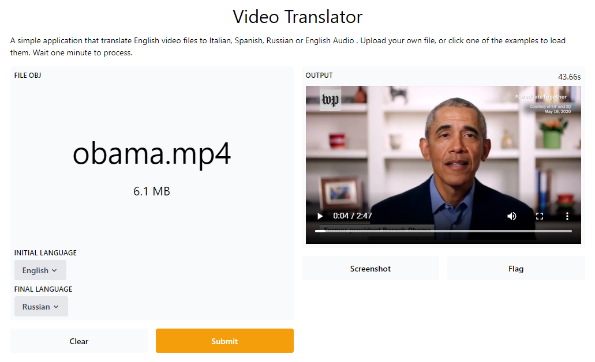

# 🎬 Video Translator

[](https://www.python.org/downloads/)
[](https://opensource.org/licenses/Apache-2.0)
[](https://github.com/psf/black)

> A production-ready, AI-powered video translation application that automatically translates video content across multiple languages using advanced speech recognition, machine translation, and natural text-to-speech synthesis.



## 🌟 Features

- **🎯 Multi-Language Support**: Translate videos between 7 languages (English, Spanish, Italian, Japanese, Russian, German, Portuguese)
- **🤖 AI-Powered Pipeline**: Leverages Google Speech Recognition, Deep Translator, and gTTS for high-quality translations
- **🎨 Modern Web Interface**: Beautiful, responsive Gradio-based UI for easy interaction
- **🏗️ Production-Ready**: Enterprise-grade code with comprehensive error handling, logging, and type hints
- **📦 Modular Architecture**: Clean, maintainable codebase following industry best practices
- **✅ Type-Safe**: Full type hinting throughout the codebase
- **📊 Progress Tracking**: Real-time progress updates during translation
- **🧪 Well-Tested**: Comprehensive test suite with pytest

## 📋 Table of Contents

- [About](#about)
- [Installation](#installation)
- [Usage](#usage)
- [Features](#features)
- [Architecture](#architecture)
- [Development](#development)
- [API Reference](#api-reference)
- [Contributing](#contributing)
- [License](#license)
- [Author](#author)

## 📖 About

Video Translator is a sophisticated application that transforms video content across language barriers. It uses a multi-stage AI pipeline to:

1. **Extract** audio from video files
2. **Recognize** speech using Google's Speech Recognition API
3. **Translate** text using advanced neural translation models
4. **Synthesize** natural-sounding speech in the target language
5. **Compose** a new video with the translated audio track

Built with modern Python practices, this application is designed for both ease of use and production deployment.

## 🚀 Installation

### Prerequisites

- **Python**: 3.9 or higher
- **uv**: Fast Python package installer ([astral-sh/uv](https://github.com/astral-sh/uv))
- **FFmpeg**: Required by moviepy for video processing

### Install FFmpeg

**Ubuntu/Debian:**
```bash
sudo apt update
sudo apt install ffmpeg
```

**macOS:**
```bash
brew install ffmpeg
```

**Windows:**
Download from [ffmpeg.org](https://ffmpeg.org/download.html) and add to PATH.

### Install Video Translator

#### Option 1: Using uv (Recommended)

```bash
# Clone the repository
git clone https://github.com/ruslanmv/Video-Translator.git
cd Video-Translator

# Install uv if you haven't already
curl -LsSf https://astral.sh/uv/install.sh | sh

# Install dependencies
make install

# For development (includes testing tools)
make install-dev
```

#### Option 2: Using pip

```bash
# Clone the repository
git clone https://github.com/ruslanmv/Video-Translator.git
cd Video-Translator

# Create virtual environment
python -m venv venv
source venv/bin/activate  # On Windows: venv\Scripts\activate

# Install in editable mode
pip install -e .
```

## 💻 Usage

### Web Interface (Gradio)

Launch the interactive web interface:

```bash
# Using make
make run

# Or directly
video-translator

# Or using Python
python -m video_translator.main
```

Then open your browser to `http://localhost:7860`

### Command Line Interface

```python
from video_translator import VideoTranslator

# Initialize translator
translator = VideoTranslator()

# Translate a single video
output = translator.translate_video(
    video_path="my_video.mp4",
    source_language="English",
    target_language="Spanish"
)
print(f"Translation complete: {output}")

# Batch translate to multiple languages
results = translator.batch_translate(
    video_path="my_video.mp4",
    source_language="English",
    target_languages=["Spanish", "French", "German"]
)

for language, output_path in results.items():
    print(f"{language}: {output_path}")
```

### Python API

```python
from video_translator.config import Config
from video_translator.translator import VideoTranslator

# Custom configuration
config = Config(
    temp_dir="./temp",
    output_dir="./output",
    max_file_size_mb=1000
)

# Initialize with custom config
translator = VideoTranslator(config)

# Translate
output = translator.translate_video(
    "video.mp4",
    "English",
    "Japanese"
)
```

## 🏗️ Architecture

### Project Structure

```
Video-Translator/
├── video_translator/           # Main package
│   ├── __init__.py            # Package initialization
│   ├── main.py                # Gradio web interface
│   ├── translator.py          # Main translation orchestrator
│   ├── video.py               # Video processing module
│   ├── audio.py               # Audio processing module
│   ├── config.py              # Configuration and constants
│   ├── exceptions.py          # Custom exceptions
│   ├── logger.py              # Logging configuration
│   └── utils.py               # Utility functions
├── tests/                      # Test suite
│   ├── __init__.py
│   ├── test_translator.py
│   ├── test_video.py
│   ├── test_audio.py
│   └── test_utils.py
├── pyproject.toml             # Project metadata and dependencies
├── Makefile                   # Automation commands
├── README.md                  # This file
├── LICENSE                    # Apache 2.0 license
└── .gitignore                # Git ignore patterns
```

### Translation Pipeline

```
┌─────────────────┐
│  Upload Video   │
└────────┬────────┘
         │
         ▼
┌─────────────────┐
│ Extract Audio   │  (moviepy)
└────────┬────────┘
         │
         ▼
┌─────────────────┐
│ Speech-to-Text  │  (Google Speech Recognition)
└────────┬────────┘
         │
         ▼
┌─────────────────┐
│   Translation   │  (Deep Translator)
└────────┬────────┘
         │
         ▼
┌─────────────────┐
│ Text-to-Speech  │  (gTTS)
└────────┬────────┘
         │
         ▼
┌─────────────────┐
│  Replace Audio  │  (moviepy)
└────────┬────────┘
         │
         ▼
┌─────────────────┐
│ Translated Video│
└─────────────────┘
```

## 🛠️ Development

### Setup Development Environment

```bash
# Install with development dependencies
make install-dev

# Or using uv directly
uv pip install -e ".[dev]"
```

### Code Quality

```bash
# Format code
make format

# Run linters
make lint

# Type checking
make type-check

# Run all checks
make check
```

### Testing

```bash
# Run tests
make test

# Run tests with coverage
make test-cov

# View coverage report
open htmlcov/index.html
```

### Available Make Commands

```bash
make help              # Show all available commands
make install           # Install production dependencies
make install-dev       # Install all dependencies (including dev tools)
make clean             # Remove build artifacts and cache
make lint              # Run code linting
make format            # Format code with black and isort
make type-check        # Run mypy type checking
make test              # Run tests
make test-cov          # Run tests with coverage report
make run               # Run the application
make build             # Build distribution packages
make ci                # Run all CI checks
```

## 📚 API Reference

### VideoTranslator

Main class for video translation operations.

```python
class VideoTranslator:
    def __init__(self, config: Optional[Config] = None)

    def translate_video(
        self,
        video_path: str,
        source_language: str,
        target_language: str,
        output_path: Optional[str] = None
    ) -> str

    def batch_translate(
        self,
        video_path: str,
        source_language: str,
        target_languages: list
    ) -> dict
```

### Supported Languages

- 🇬🇧 **English** (en-US)
- 🇮🇹 **Italian** (it-IT)
- 🇯🇵 **Japanese** (ja-JP)
- 🇷🇺 **Russian** (ru-RU)
- 🇪🇸 **Spanish** (es-MX)
- 🇩🇪 **German** (de-DE)
- 🇧🇷 **Portuguese** (pt-BR)

### Exceptions

```python
VideoTranslatorError          # Base exception
VideoProcessingError          # Video processing failures
AudioExtractionError          # Audio extraction failures
SpeechRecognitionError        # Speech recognition failures
TranslationError              # Translation failures
TextToSpeechError            # Text-to-speech failures
InvalidInputError            # Invalid input parameters
```

## 🤝 Contributing

Contributions are welcome! Please follow these steps:

1. **Fork** the repository
2. **Create** a feature branch (`git checkout -b feature/amazing-feature`)
3. **Commit** your changes (`git commit -m 'Add amazing feature'`)
4. **Push** to the branch (`git push origin feature/amazing-feature`)
5. **Open** a Pull Request

### Contribution Guidelines

- Follow PEP 8 style guidelines
- Add type hints to all functions
- Write comprehensive docstrings
- Include unit tests for new features
- Update documentation as needed
- Run `make ci` before submitting PR

## 📄 License

This project is licensed under the **Apache License 2.0** - see the [LICENSE](LICENSE) file for details.

```
Copyright 2024 Ruslan Magana

Licensed under the Apache License, Version 2.0 (the "License");
you may not use this file except in compliance with the License.
You may obtain a copy of the License at

    http://www.apache.org/licenses/LICENSE-2.0

Unless required by applicable law or agreed to in writing, software
distributed under the License is distributed on an "AS IS" BASIS,
WITHOUT WARRANTIES OR CONDITIONS OF ANY KIND, either express or implied.
See the License for the specific language governing permissions and
limitations under the License.
```

## 👤 Author

**Ruslan Magana**

- Website: [ruslanmv.com](https://ruslanmv.com)
- GitHub: [@ruslanmv](https://github.com/ruslanmv)
- Email: contact@ruslanmv.com

## 🙏 Acknowledgments

- [Gradio](https://gradio.app/) - For the amazing web interface framework
- [moviepy](https://zulko.github.io/moviepy/) - For video processing capabilities
- [gTTS](https://gtts.readthedocs.io/) - For text-to-speech synthesis
- [SpeechRecognition](https://github.com/Uberi/speech_recognition) - For speech-to-text
- [deep-translator](https://github.com/nidhaloff/deep-translator) - For robust translation

## 📊 Project Status

This project is actively maintained and production-ready. For issues, feature requests, or questions, please open an issue on GitHub.

---

<p align="center">
  Made with ❤️ by <a href="https://ruslanmv.com">Ruslan Magana</a>
</p>
